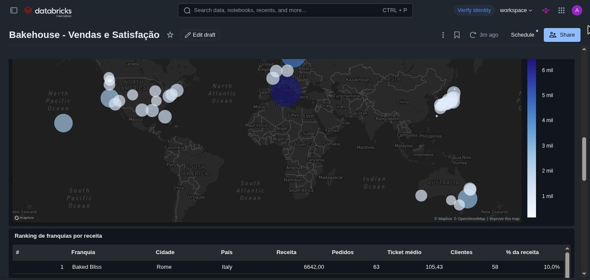
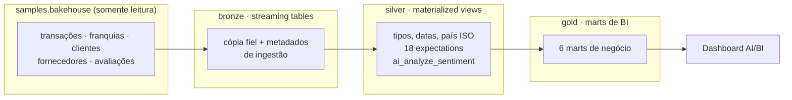
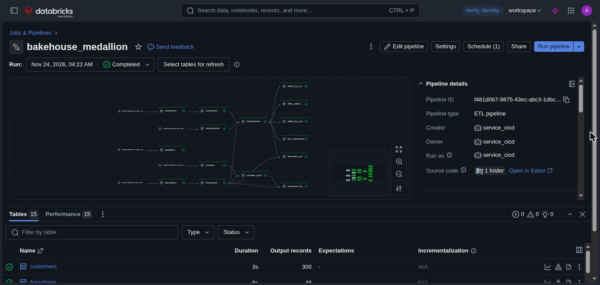
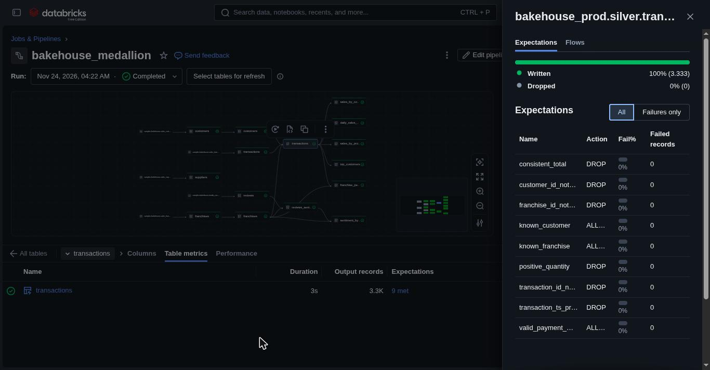
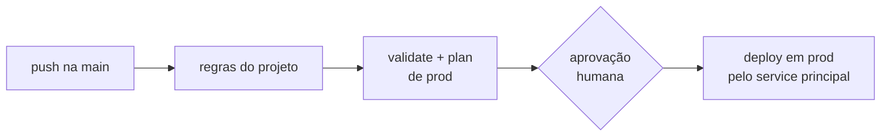
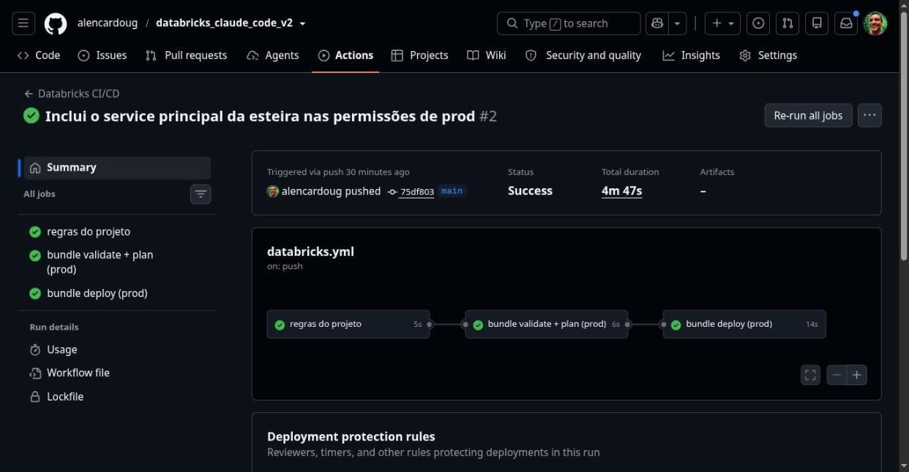
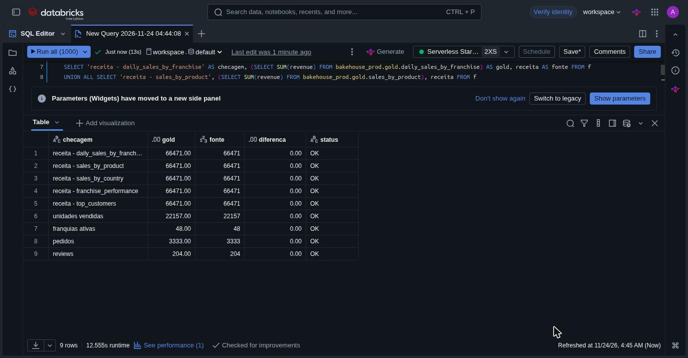

# Bakehouse Lakehouse

Pipeline de dados em **arquitetura medalhão** (bronze → silver → gold) no Databricks, com **qualidade de dados declarativa**, **análise de sentimento por IA**, **dashboard AI/BI** e **deploy em produção por esteira CI/CD com aprovação humana**.

O cenário é uma rede de padarias com **48 franquias em 9 países**. A gestão acompanha receita, pedidos, ticket médio, mix de produtos, desempenho por franquia e por país, e a satisfação dos clientes. Os dados vêm do conjunto de exemplo **Bakehouse** da Databricks (`samples.bakehouse`, somente leitura).

> Projeto desenvolvido com IA agêntica (Claude Code) a partir de uma especificação com regras explícitas de engenharia e critérios de aceite verificáveis.


<sub>Dashboard AI/BI em produção: franquias por receita no mapa e ranking. O painel também traz KPIs, receita diária, mix de pagamento, receita por produto e por país, e satisfação dos clientes.</sub>

---

## Destaques

| | |
|---|---|
| **Camadas** | 3 schemas por ambiente, 15 tabelas (5 bronze, 4 silver, 6 gold) |
| **Qualidade** | 18 expectations declarativas; 0 registros reprovados |
| **Conferência** | 17 de 17 checagens da gold contra a fonte com diferença zero em produção |
| **Ambientes** | dev e prod com o mesmo código, isolados por catálogo |
| **Esteira** | regras do projeto → validate + plan → deploy em prod com aprovação |
| **Execução** | pipeline serverless; ~80 s em produção |

## Arquitetura



Uma única **Lakeflow Declarative Pipeline** serverless materializa as três camadas. Os recursos (schemas, pipeline, job e dashboard) são declarados num **Databricks Asset Bundle**.


<sub>A pipeline em produção: fonte → bronze → silver → gold, executada pelo service principal da esteira.</sub>

### Um catálogo por ambiente

| Nível | Papel | Exemplo |
|---|---|---|
| Catálogo | fronteira do ambiente | `bakehouse_dev`, `bakehouse_prod` |
| Schema | camada medalhão | `bronze`, `silver`, `gold` |
| Tabela | entidade | `gold.franchise_performance` |

A única coisa que muda entre dev e prod é o catálogo, e quem decide é o target do bundle. Nenhum SQL ou recurso escreve o nome do catálogo ou do schema:

- **YAML:** `${var.catalog}` e `${resources.schemas.<camada>.name}`;
- **SQL:** `${medallion_catalog}.${silver_schema}.transactions`.

A esteira **barra** qualquer nome de ambiente escrito no código.

### Tabelas

| Camada | Tabelas |
|---|---|
| bronze | `transactions`, `franchises`, `customers`, `suppliers`, `reviews` |
| silver | `transactions` (enriquecida com franquia e cliente), `franchises`, `customers`, `reviews_sentiment` |
| gold | `daily_sales_by_franchise`, `sales_by_product`, `franchise_performance`, `sales_by_country`, `top_customers`, `sentiment_by_franchise` |

## Qualidade de dados

As regras ficam no próprio SQL da silver, em dois níveis de severidade:

```sql
CONSTRAINT positive_quantity    EXPECT (quantity > 0)                        ON VIOLATION DROP ROW,
CONSTRAINT consistent_total     EXPECT (total_price = quantity * unit_price) ON VIOLATION DROP ROW,
CONSTRAINT valid_payment_method EXPECT (payment_method IN ('visa', 'mastercard', 'amex')),
```

- **Críticas (`DROP ROW`):** chaves, quantidade e consistência do total. A linha inválida não chega à silver.
- **De domínio (só registro):** meio de pagamento, país e coordenadas. A linha segue, e a violação é medida a cada execução.


<sub>Qualidade medida pela própria pipeline: as 9 regras da silver `transactions`, com ação, % de falha e registros reprovados.</sub>

Dados sensíveis (número do cartão, email, telefone e endereço dos clientes) **ficam só na bronze**.

## Esteira CI/CD



[`.github/workflows/databricks.yml`](.github/workflows/databricks.yml):

1. **Regras do projeto.** Não precisa de credenciais e roda inclusive em PR de fork:
   - nenhum catálogo ou schema escrito em `src/` e `resources/`;
   - nenhum `USE CATALOG`/`USE SCHEMA`;
   - JSON do dashboard válido.
2. **`bundle validate` + `bundle plan`** do target prod.
3. **`bundle deploy -t prod`**, só em push na `main`, depois de aprovação no environment `prod` do GitHub. Um deploy por vez.

A esteira autentica como um **service principal** (OAuth M2M) com privilégio mínimo: só `USE CATALOG` e `CREATE SCHEMA` em `bakehouse_prod`. Em produção, só ele escreve; pessoas recebem acesso de leitura.


<sub>A execução que publicou a produção: regras → validate + plan → deploy, este último após aprovação manual.</sub>

## Como os números foram validados

Testar se o widget aparece não basta. A gold foi **reconciliada com a fonte** de forma independente:

| Checagem | Resultado |
|---|---|
| Receita total, pedidos, unidades, ticket médio, franquias ativas | diferença zero |
| Receita somada em cada mart | diferença zero |
| Linha a linha por dia, produto, pagamento, franquia, país e cliente | 0 divergências |
| Avaliações por franquia e sentimento gold × silver | 0 divergências |


<sub>Reconciliação da gold de produção com a fonte, no SQL Editor: diferença zero em todas as checagens.</sub>

Além disso:
- as contagens das 15 tabelas são idênticas em dev e em prod;
- cada dataset do dashboard foi executado com o mesmo SQL do painel;
- o dashboard publicado foi conferido visualmente, widget por widget.

O sentimento vem de `ai_analyze_sentiment`, que não é determinístico. Por isso ele só é conferido **dentro do mesmo ambiente**: 3 das 204 avaliações receberam rótulos diferentes em dev e em prod.

## Estrutura

```
databricks.yml                          # bundle: variáveis, targets dev/prod
resources/
  bakehouse.schemas.yml                 # schemas bronze/silver/gold
  bakehouse.pipeline.yml                # pipeline serverless + configuration
  bakehouse.job.yml                     # job que orquestra a pipeline
  bakehouse.dashboard.yml               # dashboard (dataset_catalog/dataset_schema)
src/
  pipelines/bakehouse/transformations/
    bronze/   silver/   gold/           # um arquivo SQL por tabela
  dashboards/bakehouse_overview.lvdash.json
.github/workflows/databricks.yml        # esteira CI/CD
docs/img/                               # evidências usadas neste README
pre_execucao.md                         # plano, decisões e resultados de dev e prod
```

## Como executar

**Pré-requisitos:**
- Databricks CLI 1.26 ou superior;
- os catálogos `bakehouse_dev` e `bakehouse_prod` criados **fora do bundle** (o catálogo vive mais que o projeto);
- `USE CATALOG` + `CREATE SCHEMA` neles para quem fizer o deploy.

```bash
# validar e ver o plano (use --profile se houver mais de um profile para o mesmo host)
databricks bundle validate -t dev
databricks bundle plan -t dev

# publicar e rodar em desenvolvimento
databricks bundle deploy -t dev
databricks bundle run bakehouse_medallion_job -t dev
```

Produção é publicada **só pela esteira**.

## Limitações

- Dados estáticos de exemplo. A pipeline não tem agendamento, porque a fonte não muda.
- dev e prod no mesmo workspace (Free Edition), isolados apenas por catálogo.
- Ainda não há testes automatizados das transformações na esteira.

## Próximos passos

- Agendar a pipeline de produção, com alertas sobre as métricas de qualidade.
- Adicionar testes das transformações à esteira.
- Cruzar sentimento com desempenho de vendas por franquia.

## Stack

Databricks · Unity Catalog · Lakeflow Declarative Pipelines · Databricks Asset Bundles · SQL · AI Functions · AI/BI Dashboards · GitHub Actions · OAuth M2M
